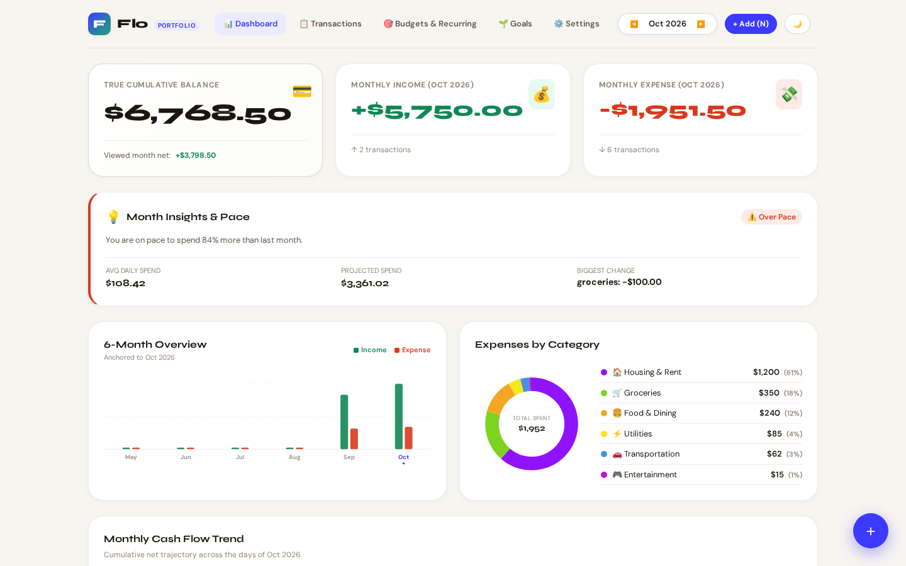
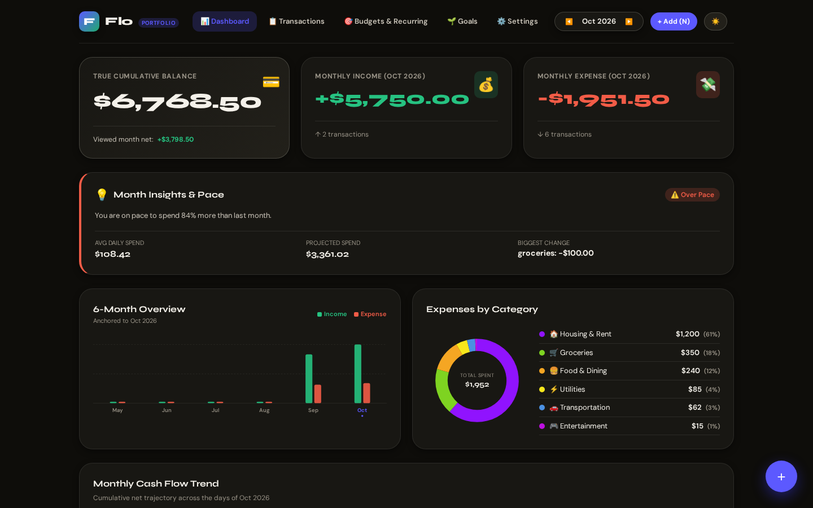
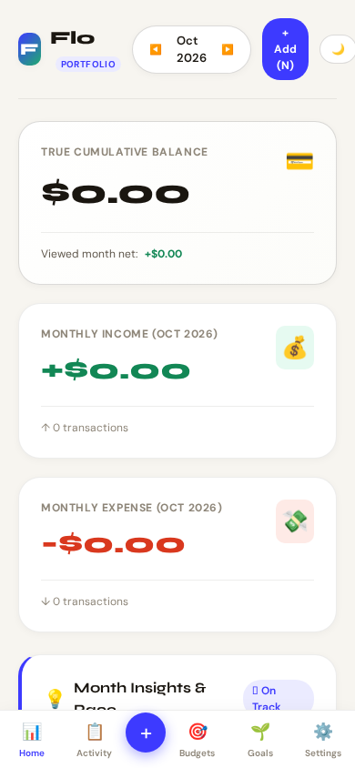
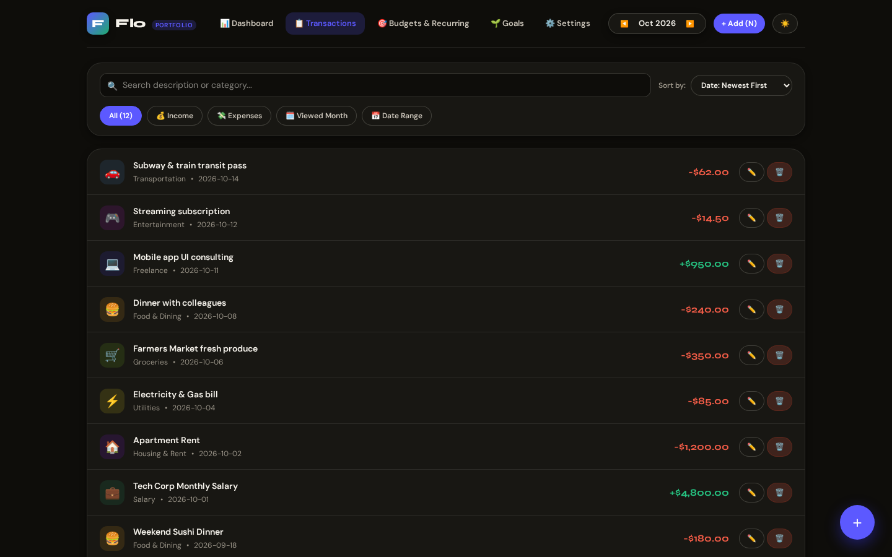
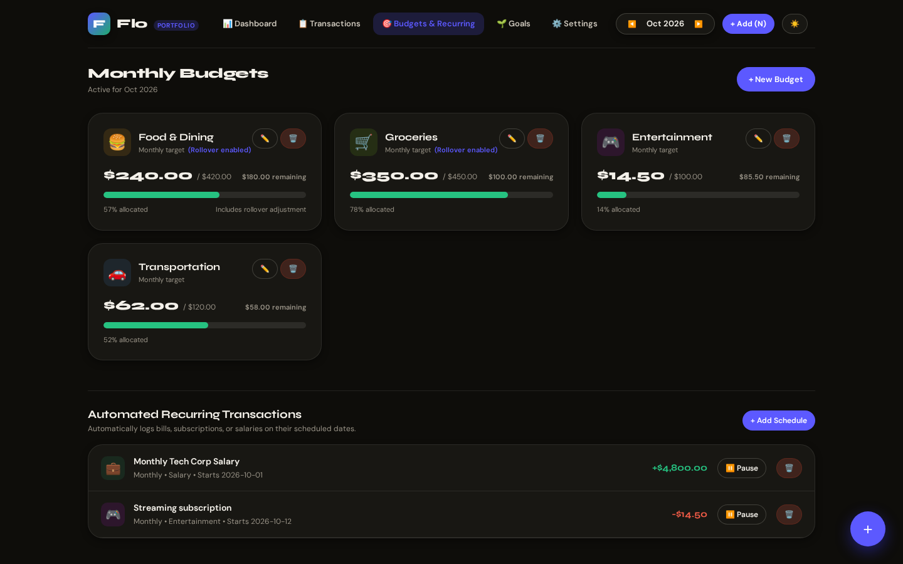
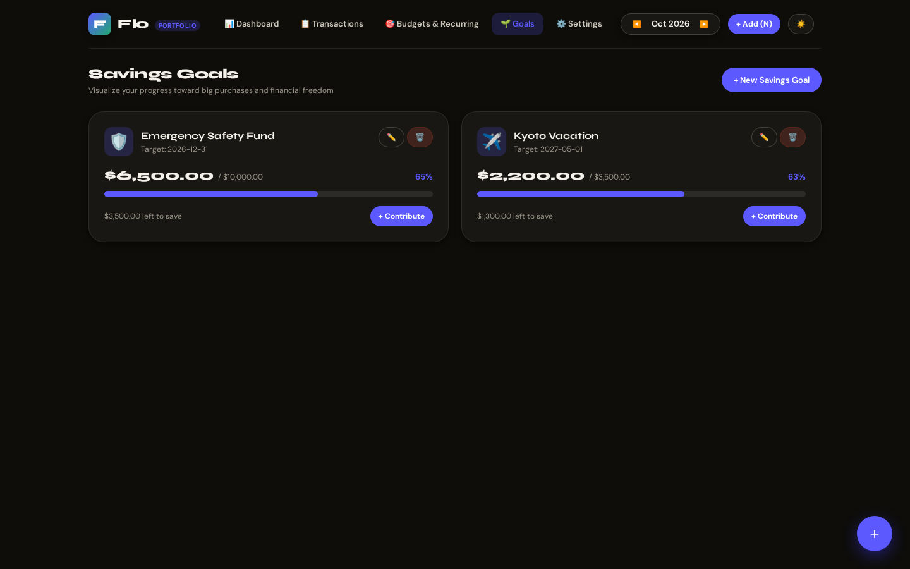

# Flo — Personal Finance Tracker

> **A fast, privacy-first, offline-ready personal finance tracker running 100% in your browser with zero backend, zero tracking, and zero paid dependencies.**

[](https://github.com/raiyanmahmud484/finance-tracker/actions/workflows/static.yml)
[](LICENSE)
[](tests/)

---

## 📸 Screenshots

| Light Mode (Desktop) | Dark Mode (Desktop) | Mobile Responsive |
| :---: | :---: | :---: |
|  |  |  |

| Activity & Search | Monthly Budgets & Rollover | Savings Goals |
| :---: | :---: | :---: |
|  |  |  |

---

## ✨ Key Features

- **🛡️ 100% Private & Local**: No sign-ups, no analytics, no third-party tracking, and no external databases. Your data never leaves your device.
- **⚡ Single Source of Truth Reactive Architecture**: Pure TypeScript and a pub/sub store with surgical pure render functions (zero React/Vue bundle overhead).
- **📊 Real Cumulative Balance vs. Monthly Net**: Fixes legacy month-only balance traps. Track your overall net worth alongside current month cash flow.
- **📈 Interactive Accessible SVG Charts**:
  - **Dynamic 6-Month Comparison**: Anchored dynamically to the viewed month (no hardcoded Jan–Jun labels).
  - **Category Donut Chart**: Trigonometrically computed SVG arcs with interactive percentage legend and center totals.
  - **Cash Flow Trajectory**: Smooth SVG gradient line/area chart showing daily net balance.
- **🎯 Smart Budgets with Rollover & Alerts**:
  - Uncapped progress indicators (highlights >100% over-budget state in red).
  - Visual 80% pace warning.
  - Optional unspent rollover surplus carry-over from previous months.
- **🌱 Savings Goals**: Set target dates, track milestone progress percentages, and make quick contributions.
- **🔄 Automated Recurring Transactions**: Weekly or monthly schedules (rent, payroll, subscriptions) with automatic occurrence generation and pause/resume switches.
- **📁 Safe Data Backup & Transfer**:
  - **Strict JSON Schema Validation**: Inspects uploaded files, displays previews ("142 transactions, 4 budgets"), and offers **Merge** or **Replace** strategies.
  - **Excel UTF-8 BOM CSV**: Exports with `\uFEFF` prefix so non-ASCII currency symbols (BDT ৳, JPY ¥, EUR €, GBP £) open cleanly in Microsoft Excel.
- **⌨️ Keyboard & Quick-Add Power**:
  - Press **`N`** anywhere to summon the transaction dialog.
  - Auto-focused amount field with instant Enter key submission.
  - Remembers last used category per description.
- **🌙 Real Dark Mode**: Automatically matches system preference (`prefers-color-scheme`) with manual toggle override.
- **📲 Progressive Web App (PWA)**: Installable to your mobile home screen or desktop, with offline caching via service worker.
- **⚡ Seeded Demo Button**: Visitors and recruiters can click **"Load Sample Data"** in Settings to test all analytics immediately.

---

## 🏗️ Architecture & Data Flow

```
┌────────────────────────────────────────────────────────┐
│                   Flo App Runtime                      │
├────────────────────────────────────────────────────────┤
│                                                        │
│  [ UI Views & Components ]                             │
│    ├── DashboardView (Summary Cards, 3 SVG Charts)     │
│    ├── TransactionsView (Search, Filters, Paging)      │
│    ├── BudgetsView (Rollover, Over-Budget, Recurring)  │
│    ├── GoalsView (Progress, Contributions)             │
│    └── Modals (Native <dialog>, Focus Trap, Escape)    │
│                     │                  ▲               │
│               Dispatches           Subscribes          │
│                     ▼                  │               │
│  [ Reactive Store (Pub / Sub) ] ───────┘               │
│    ├── State Segregation (Persistent vs UI)            │
│    ├── Undo Stack (aria-live Toast)                    │
│    └── Recurring Rule Processor                        │
│                     │                                  │
│         Syncs Domain Changes                           │
│                     ▼                                  │
│  [ Storage & Migration Engine (v2) ]                   │
│    ├── Migration from legacy 'flo_state'               │
│    ├── Integer Minor Units (Money Precision)           │
│    └── LocalStorage / IndexedDB with Error Surfacing   │
│                                                        │
└────────────────────────────────────────────────────────┘
```

### Why Vanilla TypeScript with Vite?
1. **Zero Runtime Bloat**: Eliminates virtual DOM overhead, minimizing memory consumption and ensuring instantaneous cold loads.
2. **Predictable State Transitions**: A lightweight pub/sub store ensures a single source of truth without complex external state management libraries.
3. **Type Safety & Maintainability**: Strict TypeScript interfaces guard data invariants, integer minor unit representations, and storage schemas.
4. **Static GitHub Pages Portability**: Compiles down to standard HTML/CSS/JS without requiring server-side rendering or cloud backend containers.

---

## 🛠️ Tech Stack

- **Runtime & Bundler**: [Vite](https://vitejs.dev/) + [TypeScript](https://www.typescriptlang.org/) (ES Modules)
- **Styling**: [Tailwind CSS](https://tailwindcss.com/) with native CSS Custom Properties design tokens
- **Visuals**: Handcrafted inline SVG vector charts (zero charting library dependencies)
- **PWA**: [vite-plugin-pwa](https://vite-pwa-org.netlify.app/) (Service Worker + Web App Manifest)
- **Testing**: [Vitest](https://vitest.dev/) (Unit tests) + [Playwright](https://playwright.dev/) (End-to-End tests)
- **CI/CD**: GitHub Actions (Lint, Test, Build, Deploy to GitHub Pages)

---

## 🚀 Getting Started

### Prerequisites
- Node.js 20+ (recommended: Node 22+)
- npm or bun

### Installation
```bash
git clone https://github.com/raiyanmahmud484/finance-tracker.git
cd finance-tracker
npm install
```

### Running Locally
```bash
npm run dev
```
Open [http://localhost:3000](http://localhost:3000) in your browser.

### Running Tests
```bash
npm test

npm run test:e2e

npm run lint
```

### Building for Production
```bash
npm run build
```
The optimized static output is generated in `./dist/` and is ready for GitHub Pages or static hosting.

---

## 🔒 Data Privacy & Invariants

- **Storage**: All transactions, budgets, and goals remain stored in browser `localStorage` on your physical device.
- **XSS Sanitization**: All user strings are escaped with `escapeHtml()` prior to DOM insertion, mitigating malicious script injection.
- **Integer Minor Units**: Monetary values are multiplied by currency unit factors (100 for USD/EUR/BDT, 1 for JPY/KRW) to prevent IEEE-754 decimal floating-point drift.
- **Date Arithmetic**: Month transitions use modular math on `{ year, month }` tuples, preventing the 31st day overflow bug.

---

## 🗺️ Roadmap

- [x] Phase 1: Real bug fixes (XSS, month math, timezone, money precision, storage separation)
- [x] Phase 2: Core features (Edit/delete with Undo, custom categories, recurring rules, budgets rollover, savings goals, SVG charts, insights, Excel UTF-8 BOM CSV)
- [x] Phase 3: Vite + TypeScript architecture with pub/sub store, schema migration, and PWA
- [x] Phase 4: WCAG 2.1 AA accessibility, dual theme, and responsive bottom bar
- [x] Phase 5: Vitest & Playwright test suites, CI workflow
- [x] Phase 6: Seeded portfolio sample data, complete documentation, MIT License
- [ ] Multi-currency conversion rates via local snapshot
- [ ] Receipt photo attachment stored locally via IndexedDB blobs

---

## 📄 License

This project is licensed under the [MIT License](LICENSE).
